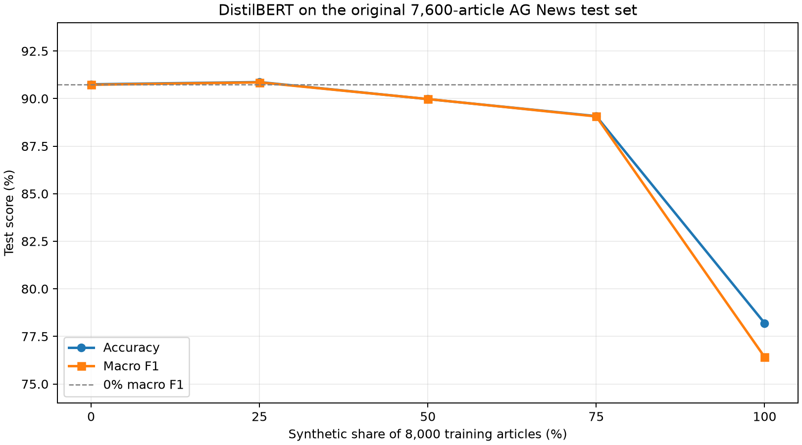
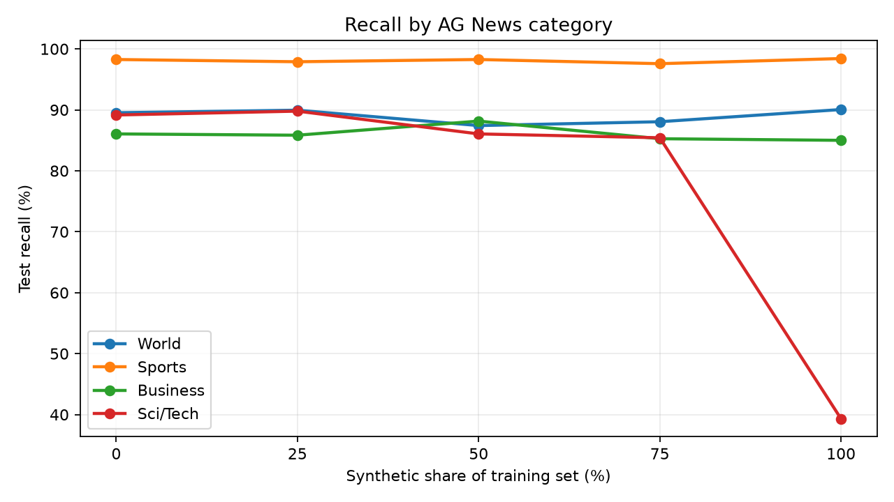
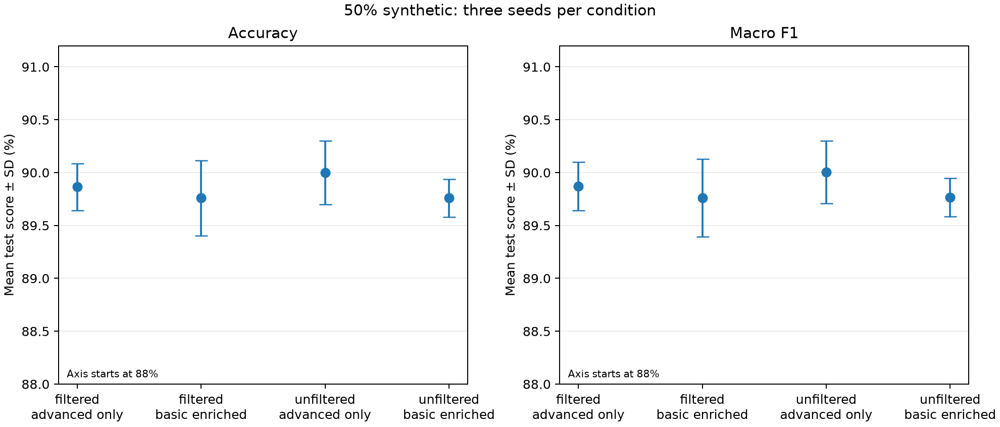
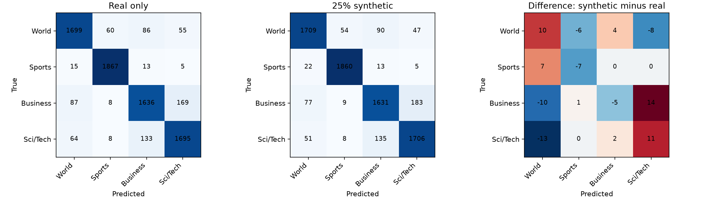

# Synthetic News Data for AG News Classification

Final scientific report | Natural Language Processing | 30 October 2026
Prepared by Oleksandr Buhrii and Maksym Khramtsov

## Abstract

Synthetic news articles can expand a training set, but their value depends on realism, diversity, and whether they preserve useful class boundaries. This study evaluates fictional AG News-style articles generated with a local Qwen3-4B model. Five balanced 8,000-item datasets replace 0%, 25%, 50%, 75%, or 100% of real training articles with synthetic articles. DistilBERT models share the same architecture, one-epoch training schedule, learning rate, weight decay, validation split, and original real AG News test set.

The 25% mixture attained the highest observed test macro F1, 0.9085, only 0.0013 above the real-only controlled baseline. At 100% synthetic, macro F1 dropped to 0.7641, with Sci/Tech recall falling to 0.3932. A three-seed 50% ablation found no clear benefit from the tested filtering or basic-prompt enrichment. Paired error analysis showed 144 corrected baseline errors and 135 newly introduced errors at 25% synthetic. These results suggest that modest augmentation can match real-only performance here, while full substitution is unreliable.

The report integrates dataset generation and quality analysis with model training, ablation, and error analysis. All numeric claims are drawn from saved notebooks, manifests, and result tables in this repository. The small test-set lead is descriptive because one training seed was used for the main mixtures and the apparent winner was identified after inspecting test outcomes.

## Keywords

Synthetic data; AG News; DistilBERT; Qwen3; text classification; data quality; ablation.

## Report map

Sections 1–3 present the research question and data. Sections 4–6 describe generation, quality control, and training. Sections 7–9 present main results, ablations, and error analysis. Section 10 discusses interpretation and limitations; Section 11 records references and individual contributions.

<!-- PAGE BREAK -->

# 1. Introduction and research question

Text classifiers require labeled examples that represent the wording and topic range encountered at evaluation time. Generative language models can create labeled examples at low marginal cost, but plausible-looking text may contain repetitive patterns, weak topic boundaries, or factual inconsistencies. Synthetic examples may therefore help by adding variation or harm by shifting the training distribution away from real news. The AG News benchmark provides a practical four-category setting for examining this trade-off [1, 2].

Our primary question is: how does replacing increasing proportions of real AG News training articles with locally generated fictional articles affect DistilBERT performance on the unchanged real test set? We also ask whether prompt specificity and quality filtering influence performance when the synthetic share is fixed at 50%, and which classification errors change when modest synthetic augmentation is added.

The study keeps 8,000 training items and equal category frequencies in every main mixture. The same 2,000 real validation items and 7,600 original test items are used throughout. This design makes the synthetic proportion the main planned change, although sample composition also changes as real examples are replaced. We evaluate accuracy, macro F1, per-class recall, confusion patterns, and paired predictions rather than relying on a single aggregate score [6].

DistilBERT is a compact, pretrained Transformer that is suitable for repeated local experiments [3]. Qwen3-4B-Instruct supplies fictional headline-and-summary articles through a local Ollama service [4, 5]. Their roles are distinct: Qwen generates training text; DistilBERT is the supervised classifier. No generated article appears in the validation or test sets.

## Study contributions

We provide a reproducible balanced data pipeline; prompt and filtering audits; five controlled mixture results; a 12-run three-seed ablation; per-example paired error analysis; saved experiment configurations and plots; and a clear statement of uncertainty and remaining limitations.

<!-- PAGE BREAK -->

# 2. Real dataset and fixed splits

The `fancyzhx/ag_news` dataset has English article text and four labels: World, Sports, Business, and Sci/Tech [2]. It exposes 120,000 original training rows and 7,600 test rows. Its text often includes a headline, short description, agency tag, byline, or HTML artifact. This matters because synthetic articles are generated as deliberately structured fictional headline-and-summary briefs rather than sampled from the same news archive.

| Split | World | Sports | Business | Sci/Tech | Total |
| Train | 2,000 | 2,000 | 2,000 | 2,000 | 8,000 |
| Validation | 500 | 500 | 500 | 500 | 2,000 |
| Test | 1,900 | 1,900 | 1,900 | 1,900 | 7,600 |

The preparation script uses seed 42 to select disjoint real train and validation subsets from the original training split. It leaves the original test set intact, then checks sizes, labels, exact duplicate texts, and overlap between splits. The resulting DatasetDict is saved under `data/processed/ag_news`. Generated synthetic CSVs are separately checked for missing text, duplicate text, valid labels and IDs, and normalized-text overlap with all real splits before training.

Each training mixture has 2,000 examples per category and exactly 8,000 examples overall. At 25% synthetic, for example, each class contributes 1,500 real and 500 synthetic examples. The held-out validation and test sets remain fully real and unchanged across models. This prevents generated examples from directly entering reported real-news evaluation, but it does not eliminate possible selection effects from choosing the best mixture after seeing test results.

The full source dataset and the prepared 8,000-item subset should not be confused. All main training scores in this report use the prepared subset; they do not describe training on all 120,000 original articles.

<!-- PAGE BREAK -->

# 3. Synthetic generation and quality control

Qwen3-4B-Instruct-2507 was run locally through Ollama as `qwen3:4b-instruct` [4, 5]. Production metadata records temperature 0.85, top-p 0.8, top-k 20, and a 180-token generation limit. Each output is parsed into a headline and summary, then stored with its label, sample ID, generation seed, model digest, and prompt hash. The initial 8,000-item pool contained 800 basic and 7,200 advanced-prompt examples, balanced at 2,000 per class.

The basic prompt asks for a short news item in a requested category, with a headline and two- or three-sentence summary of 35–80 words. The advanced prompt additionally supplies a concrete scenario, asks for specific actors and a clear news angle, and discourages stock wording. These are controlled prompt templates, not independent samples of naturally occurring news.

Filtering checks required fields, length, exact duplicates, and embedding-based near duplicates at cosine similarity 0.95. An AG News-trained embedding classifier screens possible label mismatches, with Qwen3 review of disagreements. Human and rule-based checks flag selected realism, geography, sports-format, or technical problems. The 8,000 original items fell to 7,427 after filtering; screened replacements restored 8,000 balanced items. The final source contains 7,402 advanced and 598 basic items.

| Stage | Total | World | Sports | Business | Sci/Tech |
| Initial | 8,000 | 2,000 | 2,000 | 2,000 | 2,000 |
| Filtered | 7,427 | 1,824 | 1,827 | 1,890 | 1,886 |
| Final | 8,000 | 2,000 | 2,000 | 2,000 | 2,000 |

The filtering log attributes 234 exclusions to near duplicates, 223 to potential label mismatches, 36 to user realism review, and 80 to geographic or technical review. These are workflow counts, not independently verified rates of actual errors. Automated screening can both miss implausible claims and remove useful variation.

<!-- PAGE BREAK -->

# 4. Data quality and diversity

Two distinct audits assess whether synthetic text varies enough to be useful. The prompt comparison draws 800 basic and 800 advanced articles, balanced at 200 per class. The advanced set has higher first-35-word distinct-2 in every class (0.602–0.662 versus 0.182–0.420) and higher mean embedding diversity (about 0.771 versus 0.515). The advanced texts are also longer on average, 69.2 versus 57.2 words. A separate 40-item human pilot rated realism 2.9/5 for advanced and 3.0/5 for basic, so lexical variety did not establish realism.

A second audit compares 100 real and 100 final synthetic articles per category. It measures lexical diversity over the first 35 words and semantic diversity as one minus mean within-class embedding cosine similarity over full texts. The matched sample gives mean class-level distinct-2 of 0.871 for real versus 0.740 for synthetic; mean embedding diversity is 0.896 versus 0.781.

| Class | Real distinct-2 | Synthetic distinct-2 | Real semantic | Synthetic semantic |
| World | 0.857 | 0.758 | 0.912 | 0.807 |
| Sports | 0.856 | 0.729 | 0.872 | 0.772 |
| Business | 0.882 | 0.755 | 0.900 | 0.774 |
| Sci/Tech | 0.889 | 0.719 | 0.897 | 0.772 |

The final set has no exact duplicate full texts, yet 208 articles share one of 68 repeated headlines. Frequent openings and fictional organization names indicate template-like generation. In matched topic samples, 36% of synthetic Sci/Tech items mention “AI” versus 0% of sampled real Sci/Tech items; real articles instead contain period-specific names and bylines. Such gaps demonstrate source and scenario drift, not demographic bias. They may reflect the original news archive’s date, the fictional prompt scenarios, and sample choice.

The audits are descriptive: the realism review covers only 40 items, and the real-versus-synthetic comparison covers 400 items per source. Neither can certify the entire final synthetic set.

<!-- PAGE BREAK -->

# 5. DistilBERT method and evaluation

All controlled classifiers start from `distilbert/distilbert-base-uncased` [3]. A four-label sequence-classification head is fine-tuned with the encoder. The saved model configuration specifies six Transformer layers, 12 attention heads, and 768-dimensional hidden states. Text is tokenized with the corresponding tokenizer, truncated to 128 tokens, and padded dynamically within batches.

| Setting | Main mixtures and controlled baseline |
| Training examples | 8,000; 2,000 per category |
| Epochs / seed | 1 / 42 |
| Optimizer / schedule | AdamW / linear learning-rate decay |
| Learning rate / weight decay | 5e-5 / 0.01 |
| Train / evaluation batch | 16 / 32 |
| Validation | 2,000 real items; every 100 steps |
| Final test | Original 7,600 real items |
| Hardware | RTX 4060 Laptop GPU; BF16 |

The fixed one-epoch setup was chosen for the controlled mixture comparison. A separate real-data grid tested three learning rates (2e-5, 3e-5, 5e-5) crossed with three weight decays (0, 0.01, 0.1), each for five epochs. Its highest validation macro F1 was 0.9146 at 2e-5, 0.01, epoch 5. This validation result is not a test score and that five-epoch checkpoint was not substituted into the main one-epoch mixtures.

Accuracy is the proportion of correct test labels. Macro F1 averages the four class F1 scores equally; each class F1 is the harmonic mean of its precision and recall [6]. Per-class recall is the fraction of articles with that true label correctly predicted. Confusion matrices show the number of articles for each true/predicted pair. Validation loss and macro F1 monitor training; test metrics are calculated after the model is saved. Original mixture training runtimes were recorded, but peak GPU memory was not.

<!-- PAGE BREAK -->

# 6. Main experiment: synthetic proportion

Five models were trained on 8,000 balanced items each, replacing an increasing share of real articles with the final synthetic source. All models used the same real validation and test sets. Table 4 reports original AG News test results. The 0% row is the controlled baseline from this training pipeline; an earlier standalone baseline is a different checkpoint and is excluded from this direct comparison.

| Synthetic | Real / synthetic | Accuracy | Macro F1 |
| 0% | 8,000 / 0 | 0.9075 | 0.9073 |
| 25% | 6,000 / 2,000 | 0.9087 | 0.9085 |
| 50% | 4,000 / 4,000 | 0.8997 | 0.8998 |
| 75% | 2,000 / 6,000 | 0.8908 | 0.8906 |
| 100% | 0 / 8,000 | 0.7820 | 0.7641 |

The 25% model has the highest observed macro F1, 0.00127 above the real-only model (0.127 percentage points). The difference is small and comes from one seed. The 50% and 75% mixtures score below the real-only run. The 100% model loses 0.1431 macro F1 relative to real-only. Figure 1 shows the sharp decline at full replacement; it does not imply a smooth causal response between the five tested percentages.

<!-- PAGE BREAK -->

# 7. Class-level results and confusion

Aggregate metrics can hide class-specific failures. The original test set is balanced at 1,900 articles per class, so the recall values are directly comparable. At 25% synthetic, World recall rises from 0.8953 to 0.8995 and Sci/Tech from 0.8916 to 0.8979, while Sports and Business fall slightly. At 100% synthetic, World and Sports recall remain high but Sci/Tech recall collapses to 0.3932.

| Synthetic | World | Sports | Business | Sci/Tech |
| 0% | 0.8953 | 0.9826 | 0.8605 | 0.8916 |
| 25% | 0.8995 | 0.9789 | 0.8584 | 0.8979 |
| 50% | 0.8742 | 0.9826 | 0.8816 | 0.8605 |
| 75% | 0.8805 | 0.9758 | 0.8526 | 0.8542 |
| 100% | 0.9005 | 0.9842 | 0.8500 | 0.3932 |

Business and Sci/Tech share vocabulary around firms, products, and research. The 25% model sends 183 true Business items to Sci/Tech and 135 true Sci/Tech items to Business. The corresponding real-only counts are 169 and 133. This pattern supports an ambiguous topic-boundary explanation, but the figure alone cannot identify whether synthetic training caused each individual mistake. The original five confusion matrices are saved with the experiment.

<!-- PAGE BREAK -->

# 8. Ablation at 50% synthetic

The ablation fixes 4,000 real plus 4,000 synthetic training items and 2,000 items per class. It crosses filtered versus unfiltered source data with advanced-only versus basic-enriched prompt composition at seeds 42, 123, and 2026. Every run retains the one-epoch DistilBERT setup and fixed real validation/test sets. The filtered basic pool is too small for 4,000 items; basic-enriched therefore uses 400 basic and 3,600 advanced items, compared with 4,000 advanced items in advanced-only. The prompt comparison changes only 10% of the synthetic half.

| Source | Prompt mix | Mean accuracy | Mean macro F1 ± SD |
| Unfiltered | Advanced only | 0.9000 | 0.9001 ± 0.0029 |
| Filtered | Advanced only | 0.8986 | 0.8987 ± 0.0023 |
| Unfiltered | Basic enriched | 0.8976 | 0.8977 ± 0.0018 |
| Filtered | Basic enriched | 0.8976 | 0.8976 ± 0.0037 |

The unfiltered advanced-only condition has the highest observed mean, but the differences are small compared with run-to-run spread. This experiment does not demonstrate that filtering is harmful or that advanced prompting always helps. Source pools differ, only three seeds were tested, and the basic-enriched condition changes a small fraction of training text. Peak PyTorch reserved GPU memory was recorded for these later runs, about 1.44–1.53 GiB; the original main runs did not record it.

<!-- PAGE BREAK -->

# 9. Paired error analysis

Saved 0% and 25% checkpoints were applied to the same 7,600 original test articles. Their paired outcomes are more informative than the 0.00127 macro-F1 difference alone: 6,762 items are correct in both models, 559 wrong in both, 144 fixed by the 25% model, and 135 newly wrong. The net accuracy gain is nine items.

| Paired outcome | Articles |
| Correct in both | 6,762 |
| Synthetic model fixes baseline | 144 |
| Synthetic model introduces error | 135 |
| Wrong in both | 559 |

The notebook reviews 14 examples: five new errors, five fixes, and four shared errors. Examples include news articles that mix election policy with stem-cell research or sports events with television-business angles. Such topics can legitimately trigger competing category cues. Some short test texts are noisy or appear debatable when viewed without wider context; a model disagreement is therefore not automatically evidence of a bad synthetic label.

Among incorrect predictions, mean maximum softmax confidence is 0.775 for real-only and 0.828 for the 25% model. These values are not calibrated correctness probabilities. The higher confidence on mistakes suggests that confidence should be inspected separately from accuracy before using these models in a decision workflow.

<!-- PAGE BREAK -->

# 10. Discussion, limitations, and conclusion

## Interpretation

The evidence is consistent with a narrow useful range for synthetic replacement in this setup. At 25%, generated examples may add some complementary patterns, but the gain over real-only is only nine net correct articles. As the synthetic share rises, real-news test performance declines, especially Sci/Tech recall at 100%. The diversity audit shows that generated articles are less lexically and semantically varied in matched samples, and repeated headings and scenario vocabulary may contribute to distribution mismatch. These observations support possible mechanisms, not a proven causal attribution for every error.

## Limitations

The main mixture series uses one seed and one epoch. The apparent best proportion was identified from the test table rather than selected on validation and confirmed on a new untouched test set; the reported lead is therefore exploratory. Synthetic examples are fictional and only a small pilot received human realism ratings. Prompt conditions vary in pool size and text length, and the ablation changes only 400 basic examples. Filtering is model-dependent and can both miss errors and suppress useful variation. The original AG News archive differs in time, style, bylines, and topic distribution from the generated stories. Softmax confidence is not calibrated. GPU peak memory was unavailable for the original mixture runs.

## Conclusion and next steps

Balanced modest augmentation can match real-only DistilBERT performance on this fixed AG News task, but fully synthetic training is substantially worse. A robust follow-up would select the synthetic proportion on validation data, repeat each mixture over several seeds, reserve a new untouched test set for final reporting, audit a larger blinded sample of generated articles, and investigate whether targeted generation improves the weakest class without increasing repeated templates. These changes would distinguish stable gains from chance and better explain how text quality affects classification.

<!-- PAGE BREAK -->

# 11. References, contributions, and reproducibility

## References

[1] Zhang, X., Zhao, J., & LeCun, Y. (2015). Character-level convolutional networks for text classification. NeurIPS 28. AG News source and benchmark construction. https://proceedings.neurips.cc/paper/2015/file/250cf8b51c773f3f8dc8b4be867a9a02-Paper.pdf

[2] fancyzhx. AG News dataset card. Hugging Face Datasets. Accessed October 2026. https://huggingface.co/datasets/fancyzhx/ag_news

[3] Sanh, V., Debut, L., Chaumond, J., & Wolf, T. (2019). DistilBERT, a distilled version of BERT: smaller, faster, cheaper and lighter. arXiv:1910.01108. https://arxiv.org/abs/1910.01108

[4] Qwen Team. (2025). Qwen3 technical report. arXiv:2505.09388. https://arxiv.org/abs/2505.09388

[5] Qwen Team. Qwen3-4B-Instruct-2507 model card. Hugging Face. Accessed October 2026. https://huggingface.co/Qwen/Qwen3-4B-Instruct-2507

[6] scikit-learn developers. Model evaluation: classification metrics and macro averaging. Accessed October 2026. https://scikit-learn.org/stable/modules/model_evaluation.html

## Individual contributions

Oleksandr: reproducible real-data splitting; DistilBERT baseline, hyperparameter grid, mixture training and comparison; 50% ablation runs; paired error analysis; final result consolidation and report integration. Maksym: prompt design and comparison; Qwen3 synthetic generation; quality filtering and replacement pipeline; dataset quality, diversity, and bias audits. The final report and presentation synthesize both streams.

## Reproducibility and artifact status

The repository contains `requirements.txt`, generation prompts and CSV sources, data preparation and training scripts, executed notebooks, detailed result logs, `results/final/` tables/figures, and SHA-256 hashes in `results/final/experiment_index.json`. The README gives execution order and hardware requirements. Model weights and the prepared dataset cache are excluded from Git because of size; on a fresh clone, the real split must be regenerated and models retrained to reproduce inference. The main mixture GPU-memory field remains explicitly unrecorded. This PDF and the presentation are generated from `src/build_final_submission.py`.

<!-- PAGE BREAK -->
